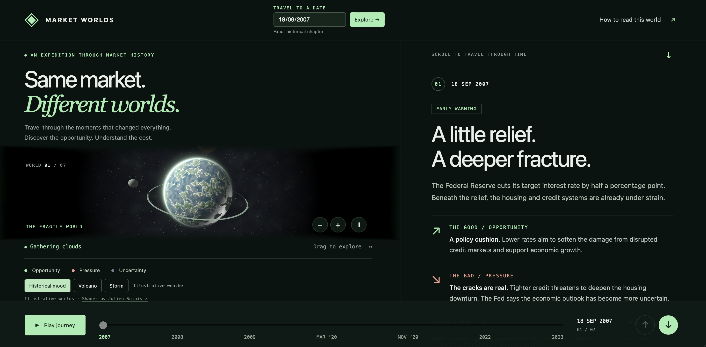
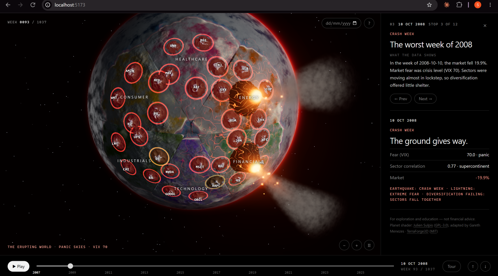
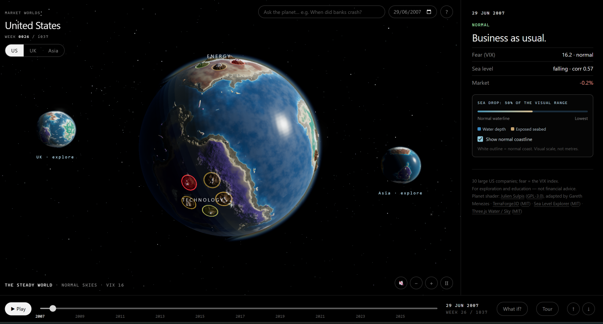
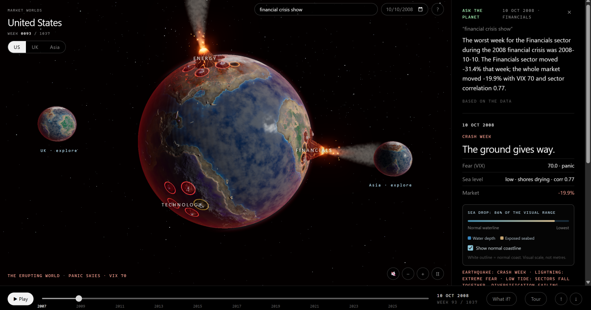

# Market Worlds - DurHack 2026 24 Hour Hackathon

**20 years of real stock market data turned into interactive 3D planets.**

Built at DurHack 2026 for the Marshall Wace **"New Worlds" Challenge**.

## Development Progress

## Demo Video

[](https://youtu.be/Iji78dfHnqs)

*Click the image to watch the demo on YouTube.*

**1. Initial prototype**

*First working version of the planet with basic terrain.*

**2. Midway**

*Added sectors as continents, weather and the timeline.*

**3. Final version**

*Full planet with storms, oceans and company mountains.*


*A crisis moment showing the market data in action.*

## The Idea

Stock markets contain huge amounts of data, but most of the time we just look at them through graphs and numbers.

We wanted to make this more interesting and easier to understand.

Market Worlds takes real financial data and turns it into a 3D planet that changes depending on what's happening in the market.

Each sector is represented by a continent, and each company is a mountain. When a company's share price increases, its mountain grows. When the market becomes more volatile, the weather gets worse, with storms, lightning and even volcanic eruptions during major crashes.

We created three different planets representing the **US, UK and Asia-Pacific markets**.

You can travel through nearly 20 years of market history and see how events like the 2008 financial crisis, COVID-19 and the AI boom affected each market.

## How It Works

Everything you see on the planet is linked to real financial data.

| Market Data | What Happens on the Planet |
| --- | --- |
| Market sectors | Each sector becomes a continent |
| Companies | Each company is represented by a mountain |
| Share price growth since 2007 | Mountains grow or shrink based on performance |
| Weekly returns | Green or red rings show whether a company gained or lost value |
| Market volatility | Higher volatility causes storms, darker skies and lightning |
| Correlation between sectors | Higher correlation causes sea levels to fall |
| Market crashes (weekly fall over 7%) | Earthquakes and volcanic eruptions |
| Extreme single-day falls | Meteor strikes that leave craters |

For the US market, we use the VIX index to measure market fear. For the UK and Asia-Pacific, we calculate volatility using historical price data.

## The Main Idea Behind It

One thing we wanted to show is how markets behave differently during a crisis.

Normally, sectors don't always move in the same direction. For example, technology might be performing well while energy is struggling.

However, during a major financial crisis, sectors tend to move together, with many falling at the same time.

We represent this using the sea level.

When correlation between sectors increases, the sea level drops, exposing more of the coastline. This becomes particularly noticeable during the 2008 financial crisis and the COVID crash in March 2020.

As markets recover and correlation decreases, the water gradually returns.

This helps demonstrate why diversification doesn't always protect investors during major market crashes.

## Features

- **Interactive 3D Planets** — Explore real financial market data from January 2007 to November 2026.
- **Three Different Markets** — Switch between the US, UK and Asia-Pacific. Each planet contains six sectors and 30 companies. The other two planets also appear nearby and can be clicked to travel between markets.
- **Time Travel** — Play through market history week by week, move the timeline manually or jump straight to a specific date.
- **Guided Tours** — Explore important financial events. The US has 12 guided stops with explanations, while the UK and Asia-Pacific tours are generated using their own market data.
- **Ask the Planet** — Search for companies, sectors and historical events. For example, you can ask "What happened during the 2008 financial crisis?" or "How did Apple perform?". With an API key, Claude can answer more general questions. Without one, the built-in search still supports companies, sectors, dates and major events.
- **AI Explanations** — Click on a mountain or continent to view its financial data and get an explanation of what happened during that period. If AI isn't available, the application generates an explanation directly from the data.
- **What If? Simulator** — Test how a sudden change in one sector might affect others. For example, you can simulate a 30% drop in Energy and compare how other sectors might react in normal market conditions versus a crisis. This uses a simple model based on historical data.
- **Meteor Strikes** — Major single-day falls are shown as meteor impacts. Clicking a crater shows when the event happened and how much the market fell.
- **Dynamic Sound Effects** — The planet also has sounds generated through code, including wind, waves, thunder, earthquakes and meteor impacts. Audio is off by default.

## Tech Stack

| Component | Technologies |
| --- | --- |
| Data collection and processing | Python, pandas, NumPy, yfinance |
| 3D visualisation | Three.js, GLSL shaders, Vite, JavaScript |
| Audio | Web Audio API |
| AI explanations | FastAPI, Anthropic Claude API (optional) |

## Running the Project

You'll need **Node.js 18+** to run the application.

Python 3.10+ is only needed if you want to rebuild the dataset or use the AI backend.

### 1. Clone the Repository

```bash
git clone https://github.com/GarethMenezes/MarketWorld.git
cd MarketWorld
```

### 2. Install Dependencies

```bash
npm install
```

### 3. Start the Application

```bash
npm run dev
```

Open the local URL shown in your terminal.

All the processed market data is already included in the `public/` folder, so the main application works without an internet connection.

### Jumping to Specific Events

You can use URL parameters to open particular markets and dates:

- `?week=2008-10-10` — The 2008 financial crisis
- `?week=2020-03-20` — The COVID market crash
- `?market=uk` — UK market
- `?market=asia` — Asia-Pacific market

You can also combine market and date parameters.

### Using AI Explanations (Optional)

To enable Claude-powered explanations, run the Python backend:

```bash
python -m venv .venv
source .venv/bin/activate
# Windows: .venv\Scripts\activate

pip install -r requirements.txt
export ANTHROPIC_API_KEY=your-key
# Windows PowerShell:
# $env:ANTHROPIC_API_KEY="your-key"

uvicorn server.app:app --port 8000
```

The API key is only used on the backend and isn't exposed to the browser.

AI is completely optional. Without an API key, the planet and its other features still work.

### Rebuilding the Market Data

To download and process the data again:

```bash
python build_world.py --market all
```

You can also choose an individual market using `us`, `uk` or `asia`. Add `--cached` to reuse previously downloaded data.

To run the tests:

```bash
npm test
```

## How We Built It

The project is split into a few main parts.

**1. Collecting the data**

We used Python and yfinance to download historical stock prices going back to 2007. Each market contains 30 companies across six sectors, with five companies in each sector.

**2. Processing the data**

Using pandas and NumPy, we calculated weekly returns, share price growth, volatility and correlations between sectors.

We also identified major crashes and extreme daily price movements to use for the earthquakes, volcanoes and meteor effects.

The processed results are saved as JSON files, roughly 1 MB per market.

**3. Building the 3D planet**

We used Three.js and custom GLSL shaders to create the planet, including its terrain, oceans, clouds, atmosphere and volcanoes.

As you move through the timeline, the financial data updates the mountains, weather and sea levels.

**4. Adding AI**

We built a FastAPI backend that retrieves the actual market data for the selected company, sector and date.

This information is passed to Claude, which generates a short explanation based on the available figures. The backend also checks the response against the data.

If the AI isn't available, the application uses its own data-based explanations instead.

## Limitations

- **Not financial advice:** The application is designed for education and exploring historical market behaviour, not making investment decisions.
- **Company selection:** Each market contains 30 selected companies, so the planets don't represent official stock market indices.
- **Survivorship bias:** We mainly use companies that are large today and have data going back to 2007. This means companies that collapsed, such as Lehman Brothers, aren't represented.
- **Mountain sizes:** Mountain height represents share price growth rather than actual company market capitalisation.
- **Volatility:** The US uses the VIX, while the UK and Asia-Pacific use calculated historical volatility.
- **Currency:** Asia-Pacific returns are calculated using each company's local currency.
- **Sea levels:** These represent correlation between sectors rather than actual physical sea levels.
- **What If? simulator:** This uses a basic linear model based on historical relationships. It isn't intended to predict future market movements.
- **AI explanations:** The AI uses the available financial data and won't always be able to explain the underlying reason behind a price movement.

## Credits

We used and adapted parts of several open-source projects:

- [Realtime Planet Shader](https://github.com/jsulpis/realtime-planet-shader) by Julien Sulpis (GPL-3.0).
- [TerraForge3D](https://github.com/Jaysmito101/TerraForge3D) (MIT) for the volcano geometry.
- [Sea Level Explorer](https://github.com/archimedix/sea-level-explorer) (MIT) for ocean colours and coastline references.
- [Three.js](https://github.com/mrdoob/three.js) Sky and Water examples (MIT) for atmospheric and water lighting.
- Yahoo Finance through yfinance for historical market data.

Additional licensing and attribution details can be found in [NOTICES.md](NOTICES.md).

## Team

Developed at **DurHack 2026** by:

- Gareth Menezes
- Sota

## Licence

See [LICENSE](LICENSE) for the project's licence.

The planet shader (`shaders/planet.frag.glsl`) is licensed under GPL-3.0, meaning distributed builds containing it must comply with the GPL-3.0 requirements.

Additional details are available in [NOTICES.md](NOTICES.md).
